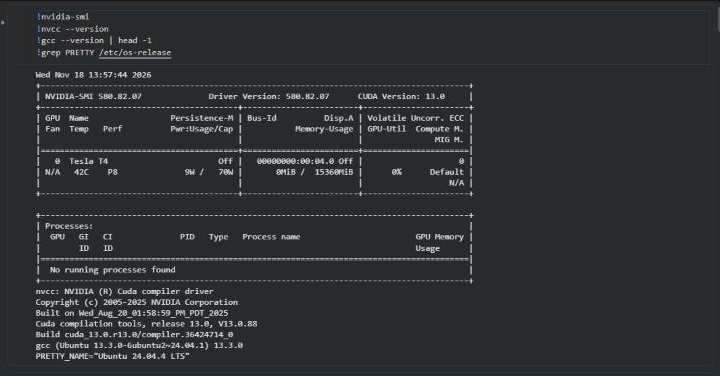
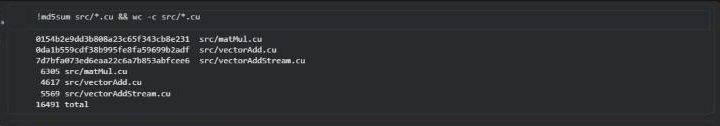
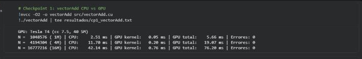
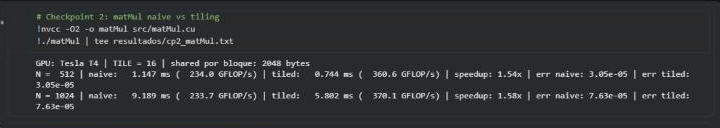
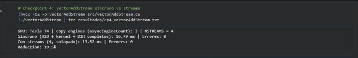
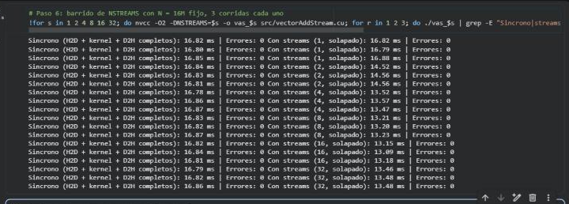

# Post-Contenido 1 — CUDA Benchmark CPU vs GPU

**Arquitectura de Computadores · Unidad 11 · Post-contenido**

| Dato | Valor |
|---|---|
| Estudiante | Juan Camilo Durán Bohórquez |
| Código | 1152532 |
| Repositorio | duran-post1-u11 |

## Descripción del laboratorio

El laboratorio tiene dos partes en el mismo repositorio. En la Parte 1 se escribieron tres programas CUDA en C, una suma de vectores, una multiplicación de matrices con tiling en shared memory y una suma de vectores con streams y `cudaMemcpyAsync`, y se midió todo contra la CPU con `cudaEvent`. En la Parte 2 se hizo un análisis comparativo de GPU, TPU, NPU y FPGA con datos reales de MLPerf Inference v4.1, que está en [docs/analisis-comparativo.md](docs/analisis-comparativo.md).

## Estructura del repositorio

```
duran-post1-u11/
├── README.md
├── src/
│   ├── vectorAdd.cu          Paso 2, suma de vectores CPU vs GPU
│   ├── matMul.cu             Paso 3, naive vs tiling en shared memory
│   └── vectorAddStream.cu    Paso 4, síncrono vs streams
├── docs/
│   └── analisis-comparativo.md   Parte 2
├── resultados/               salida de texto de cada corrida
└── capturas/                 capturas de las celdas de Colab
```

## Entorno

| Elemento | Valor |
|---|---|
| Plataforma | Google Colab con entorno de GPU T4 |
| GPU | NVIDIA Tesla T4, compute capability 7.5, 40 SM, 15360 MiB GDDR6, PCIe Gen3 x16 |
| Driver | 580.82.07 |
| CUDA | nvcc 13.0, V13.0.88 |
| CPU del host | Intel Xeon a 2.00 GHz con 2 vCPU y 12 GB de RAM |
| Sistema | Ubuntu 24.04.4 LTS |
| Compilador host | gcc 13.3.0 |

El equipo del estudiante tiene solo una Intel Iris Xe y no tiene WSL, entonces la Parte 1 se corrió en Google Colab como dice la guía. Colab ya trae CUDA 13.0 y no la 12.x de los prerrequisitos, pero el código usa solo la API de runtime clásica y compiló igual sin warnings. Para que lo que corrió en Colab sea lo mismo que está en el repo se sacó el `md5sum` de los tres `.cu` en Colab y coincidió con el de los archivos locales, se ve en la captura `p1_cp0_md5_fuentes.png`.




## Compilación y ejecución

```bash
nvcc -O2 -o vectorAdd src/vectorAdd.cu && ./vectorAdd
nvcc -O2 -o matMul src/matMul.cu && ./matMul
nvcc -O2 -o vectorAddStream src/vectorAddStream.cu && ./vectorAddStream
# barrido del Paso 6, NSTREAMS se cambia al compilar
for s in 1 2 4 8 16 32; do nvcc -O2 -DNSTREAMS=$s -o vas_$s src/vectorAddStream.cu && ./vas_$s; done
```

Los kernels son los de la guía. Lo que se agregó es la macro `CUDA_CHECK`, que revisa cada llamada a la API y `cudaGetLastError()` después de cada lanzamiento, un lanzamiento de calentamiento antes de medir para no contar el arranque del contexto, la verificación contra CPU en `vectorAddStream.cu` y el `#ifndef NSTREAMS` para poder hacer el barrido. En `vectorAdd.cu` se agregaron `#include <math.h>` y `#include <time.h>`, que el código de la guía usa con `fabs` y `clock` pero no incluye.

---

# Parte 1: Benchmark CUDA CPU vs GPU

## Paso 2: Suma de vectores

Se corrió para 1M, 4M y 16M elementos. El tiempo de kernel se mide con `cudaEvent` solo alrededor del lanzamiento, y el tiempo GPU total va desde antes de las dos copias H2D hasta después de la copia D2H.

| N | CPU | GPU kernel | GPU total con `cudaMemcpy` | Kernel contra CPU | Total contra CPU | Errores |
|---|---|---|---|---|---|---|
| 1M | 2.51 ms | 0.05 ms | 5.66 ms | 50x | 0.44x | 0 |
| 4M | 11.70 ms | 0.20 ms | 19.07 ms | 58x | 0.61x | 0 |
| 16M | 42.14 ms | 0.76 ms | 76.20 ms | 55x | 0.55x | 0 |

Lo primero que llama la atención es que el kernel salió más rápido que lo que dice la guía, 0.76 ms contra unos 1.8 ms. Haciendo la cuenta, el kernel con 16M lee 8 bytes y escribe 4 por elemento, son 201 MB en 0.76 ms, unos 265 GB/s, y la T4 tiene 320 GB/s de memoria, o sea que el kernel va al 83% del ancho de banda de la tarjeta. Lo otro que salió raro es el tiempo total, 76 ms, mucho más que lo que tarda la CPU sola. Eso pasa porque `vectorAdd.cu` usa `malloc` normal, memoria paginable, y el driver tiene que copiar primero a un buffer pinned y de ahí a la GPU, la transferencia efectiva sale a unos 2.6 GB/s. En el Paso 4 con `cudaHostAlloc` los mismos 201 MB pasaron en 16.8 ms, más de 4 veces más rápido.

**Checkpoint 1**



## Paso 3: Multiplicación de matrices con tiling

Se agregó un kernel `matMulNaive` sin shared memory para comparar, y una multiplicación en CPU en orden i-k-j como referencia. Cada kernel se lanzó 10 veces y se tomó el promedio.

| N | Naive | Tiling TILE=16 | Speedup | GFLOP/s naive | GFLOP/s tiling | Error máximo contra CPU |
|---|---|---|---|---|---|---|
| 512 | 1.147 ms | 0.744 ms | 1.54x | 234.0 | 360.6 | 3.05e-05 |
| 1024 | 9.189 ms | 5.802 ms | 1.58x | 233.7 | 370.1 | 7.63e-05 |

Los dos kernels dan el mismo error, muy por debajo de 1e-3, y el error crece con N porque se suman más productos en float. La mejora del tiling salió menor de lo que se esperaba, apenas 1.5x y no algo cercano a 16x. Revisando se entiende, en la T4 la versión naive no va de verdad a memoria global en cada acceso, los 16 hilos de una fila del bloque leen el mismo `A[row*N+k]` y los de una columna leen elementos seguidos de `B`, entonces la L1 y la L2 atienden casi todo. El tiling ahorra tráfico a la L2, pero luego cada multiplicación hace dos lecturas de shared memory y con TILE=16 el kernel queda limitado por esas lecturas, por eso llega a 370 GFLOP/s, cerca del 4.5% de los 8.1 TFLOPS FP32 de la T4.

**Checkpoint 2**



## Análisis de resultados

El kernel de GPU gana tanto en N grande porque la suma de vectores es un trabajo totalmente paralelo, cada elemento es independiente, y la T4 lanza 65536 bloques de 256 hilos sobre 40 SM, mientras la CPU de Colab recorre el arreglo con un solo hilo. Además el kernel está limitado por memoria y la GPU tiene 320 GB/s de GDDR6 contra unos pocos GB/s que alcanza un núcleo de la Xeon. Con 1M elementos el kernel tarda 0.05 ms y casi todo es el costo de lanzar el grid, con 16M sube a 0.76 ms de forma casi lineal, y la relación con la CPU se mantiene entre 50x y 58x.

El tiempo total con `cudaMemcpy` sale peor que la CPU en todos los tamaños porque la suma hace solo una operación por cada 12 bytes que se mueven, y mover esos bytes por PCIe es mucho más lento que hacer la suma en la CPU donde ya están los datos. En N pequeño se nota aún más, con 1M la copia y la latencia fija de cada `cudaMemcpy` ya cuestan 5.66 ms contra 2.51 ms de la CPU. La GPU solo conviene cuando los datos se quedan en la tarjeta para varias operaciones o cuando el cómputo por byte es alto, como en `matMul`, donde con N=1024 se hacen 2147 millones de operaciones sobre 12 MB de datos.

## Paso 4: Transferencia asíncrona con streams

| Versión | Tiempo total | Errores |
|---|---|---|
| Síncrona, H2D + kernel + D2H completos | 16.79 ms | 0 |
| 4 streams solapados | 13.52 ms | 0 |
| Reducción | 19.5% | |

El programa imprimió `asyncEngineCount: 3`, esta T4 tiene 3 motores de copia. Las dos versiones dan 0 errores contra la suma hecha en CPU, y antes de la versión con streams se limpian `h_C` y `d_C` para que la verificación no use el resultado de la síncrona. La reducción salió de 19.5%, más que el 11.7% de la guía, y en el Paso 5 se explica de dónde sale.

**Checkpoint 4**



## Paso 5: Decisión técnica — ¿cudaMemcpyAsync con streams o transferencia síncrona para vectorAdd?

Con N=16M se mueven 64 MB por cada arreglo, 192 MB en total. A 10 a 12 GB/s eso son entre 16 y 19 ms, y en la T4 la versión síncrona tardó 16.79 ms, o sea unos 12 GB/s efectivos, aunque la T4 es PCIe Gen3 x16 y no 4.0. El kernel de 16M tardó 0.76 ms, más de 20 veces menos que la transferencia, así que vectorAdd es claramente memory-bound. Si los streams solo pudieran esconder el cómputo dentro de la transferencia, el ahorro máximo sería ese 0.76 ms, un 4.5% del total, porque el solapamiento solo puede ocultar la parte más pequeña. Lo que se midió fue 19.5%, y eso sorprendió. La razón es que la T4 tiene varios motores de copia y PCIe es full duplex, entonces con streams la copia D2H de un chunk va al mismo tiempo que la H2D del siguiente. La cuenta da bien, las dos H2D de 128 MB tardan unos 11.2 ms y la D2H de 64 MB unos 5.6 ms, y con 4 chunks solo queda sin solapar la parte final de un chunk, 11.2 más 6.4 entre 4 da unos 12.8 ms, y se midió 13.5 ms. Aun así el piso es la propia transferencia, ningún número de streams baja de esos 11.2 ms. Para vectorAdd usar streams ayuda poco y el beneficio real sería no mover los datos, o fusionar más operaciones sobre los datos ya en la GPU. En `matMulTiled` el cómputo es O(N³) sobre O(N²) datos, con N=1024 el kernel tardó 5.8 ms para solo 12 MB de datos, alrededor de 1 ms de copia, ahí el kernel domina y los streams sí permiten esconder casi toda la transferencia.

## Paso 6: Decisión técnica — ¿Cuántos streams usar, y qué limita la ganancia al aumentar su número?

Se compiló `vectorAddStream.cu` con `-DNSTREAMS` de 1 a 32 y se corrió 3 veces cada uno, siempre con N=16M.

| NSTREAMS | Corridas con streams | Promedio | Reducción contra síncrono |
|---|---|---|---|
| 1 | 16.82, 16.79, 16.88 ms | 16.83 ms | 0.0% |
| 2 | 14.52, 14.56, 14.56 ms | 14.55 ms | 13.5% |
| 4 | 13.52, 13.57, 13.47 ms | 13.52 ms | 19.6% |
| 8 | 13.21, 13.20, 13.23 ms | 13.21 ms | 21.5% |
| 16 | 13.15, 13.09, 13.18 ms | 13.14 ms | 21.9% |
| 32 | 13.46, 13.48, 13.48 ms | 13.47 ms | 19.9% |

El tiempo no baja de forma proporcional. De 1 a 2 streams se ganan 2.3 ms, de 2 a 4 un 1 ms, de 4 a 16 apenas 0.4 ms y con 32 vuelve a subir. Lo que limita es lo que todos los streams comparten, el ancho de banda del bus PCIe y los motores DMA físicos. La T4 reporta 3 copy engines, pero en la práctica solo hay dos sentidos en el bus, uno para H2D y otro para D2H, y con 2 a 4 streams ya hay siempre una copia de subida, una de bajada y un kernel en curso, el pipeline queda lleno. Agregar más streams no crea más motores ni más GB/s, solo parte la misma transferencia en trozos más pequeños, y cada trozo paga su propia latencia de lanzamiento y de sincronización, por eso con 32 chunks de 2 MB el tiempo empeora. Dividir en más streams tampoco reduce el tiempo total de transferencia, los 128 MB de subida siguen tardando unos 11.2 ms porque el bus da lo mismo, lo único que cambia es cuándo se mueve cada parte para que se solape mejor con el kernel y con la copia de vuelta. Para esta GPU lo razonable es usar entre 4 y 8 streams.

**Checkpoint 5**



---
